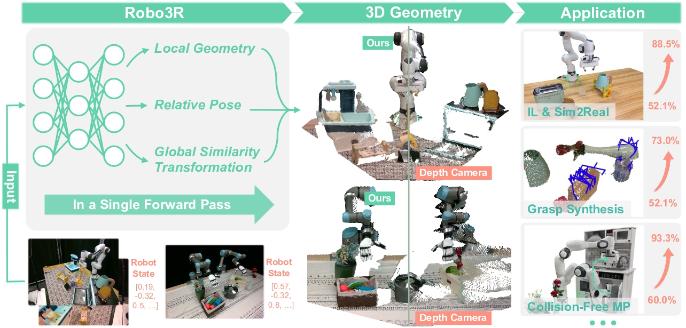

<br>
<p align="center">
  <h1 align="center"><strong>Robo3R: Enhancing Robotic Manipulation with Accurate Feed-Forward 3D Reconstruction</strong></h1>
  <p align="center">
    Sizhe Yang, Linning Xu, Hao Li, Juncheng Mu, Jia Zeng, Dahua Lin, Jiangmiao Pang
    <br>
    Shanghai AI Laboratory, The Chinese University of Hong Kong, University of Science and Technology of China, Tsinghua University
    <br>
  </p>

  <p align="center"><strong>RSS 2026</strong></p>
</p>

<div id="top" align="center">

[](https://arxiv.org/abs/2602.10101)
[](https://yangsizhe.github.io/robo3r/)

</div>


## 📋 Contents
- [🔥 Highlight](#highlight)
- [🗂️ Dataset](#dataset)
- [🚀 Getting Started](#getting-started)
- [🔗 Citation](#citation)
- [📄 License](#license)
- [👏 Acknowledgements](#acknowledgements)


## 🔥 Highlight <a name="highlight"></a>

**Robo3R** enables manipulation-ready 3D reconstruction from RGB frames in real time.

By achieving accurate metric-scale 3D geometry in the canonical robot frame, Robo3R **eliminates the need for depth sensors and calibration, while improving accuracy and robustness** in challenging manipulation scenarios.

These features **lead to notable improvements in downstream applications** such as imitation learning, sim-to-real transfer, grasp synthesis, and collision-free motion planning.

<div align="center">
    
</div>

## 🗂️ Dataset <a name="dataset"></a>

Our curated large-scale dataset is available at [🤗 Robo3R-4M Dataset - Huggingface](https://huggingface.co/datasets/yangsizhe/Robo3R).

The dataset is generated with the **Franka FR3** robot and contains the following subsets:

- **`100kScenes_dtc-objaverse_not-in-gripper`**: 100k scenes where objects are randomly placed on the tabletop.
- **`20kScenes_dtc-objaverse_in-gripper`**: 20k scenes where one object is grasped by the gripper, and the remaining objects are randomly placed on the tabletop.

The dataset is split into multiple `.tar.gz.part*` files for upload. After downloading, concatenate the parts and extract them with the following commands:

```bash
# 100kScenes_dtc-objaverse_not-in-gripper
cd 100kScenes_dtc-objaverse_not-in-gripper
cat 100kScenes_dtc-objaverse_not-in-gripper.tar.gz.part* > 100kScenes_dtc-objaverse_not-in-gripper.tar.gz
tar -xzvf 100kScenes_dtc-objaverse_not-in-gripper.tar.gz
cd ..

# 20kScenes_dtc-objaverse_in-gripper
cd 20kScenes_dtc-objaverse_in-gripper
cat 20kScenes_dtc-objaverse_in-gripper.tar.gz.part* > 20kScenes_dtc-objaverse_in-gripper.tar.gz
tar -xzvf 20kScenes_dtc-objaverse_in-gripper.tar.gz
cd ..
```

(Optional) Download and extract the dataset for evaluation.

```bash
# 1kScenes_in-gripper_test
cd 1kScenes_in-gripper_test
tar -xzvf 1kScenes_in-gripper_test.tar.gz
cd ..

# 1kScenes_not-in-gripper_test
cd 1kScenes_not-in-gripper_test
tar -xzvf 1kScenes_not-in-gripper_test.tar.gz
cd ..
```

The structure of the dataset is detailed below:

```text
scene_{str(scene_idx).zfill(8)}
├── rgb
│   ├── {str(frame_idx).zfill(4)}_{str(camera_idx).zfill(2)}.jpg
│   └── ...
├── depth
│   ├── {str(frame_idx).zfill(4)}_{str(camera_idx).zfill(2)}.png
│   └── ...
├── mask
│   ├── {str(frame_idx).zfill(4)}_{str(camera_idx).zfill(2)}.png
│   └── ...
├── qpos
│   ├── {str(frame_idx).zfill(4)}.npy
│   └── ...
├── ee_pose
│   ├── {str(frame_idx).zfill(4)}.npy
│   └── ...
├── keypoint_3d
│   ├── {str(frame_idx).zfill(4)}.npy
│   └── ...
├── keypoint_2d
│   ├── {str(frame_idx).zfill(4)}_{str(camera_idx).zfill(2)}.npy
│   └── ...
└── cam_param.npy
```

**Notes:**

- **`rgb/`**: RGB images captured from each camera.
- **`depth/`**: Depth maps in metric units.
  - Background pixels have a depth value of `0`.
  - When saved as PNG, depth is scaled by `10.0 * 2**16`:
    ```python
    depth = (depth / 10.0 * 2**16).astype(np.uint16)
    from PIL import Image
    Image.fromarray(depth).save('depth.png')
    ```
- **`mask/`**: Segmentation masks. Values for *table*, *robot*, and *object* are `50`, `100`, and `150`, respectively.
- **`qpos/`**: Joint positions of the robot.
- **`ee_pose/`**: End-effector pose of the robot.
- **`keypoint_3d/`**: Coordinates of keypoints in the robot frame.
- **`keypoint_2d/`**: Projection of `keypoint_3d` onto the image plane.
- **`cam_param.npy`**: Camera intrinsics and extrinsics for all cameras.
  - Shape: `(2, num_cameras, 4, 4)`.
  - The first dimension indexes intrinsics (`[0]`) and extrinsics (`[1]`).
  - The original `(3, 3)` intrinsics matrix is padded with an extra row and column so it shares the same shape as the extrinsics, allowing both to be stored in a single array.
- **Camera axes**: `+Z` up, `+X` forward.


## 🚀 Getting Started <a name="getting-started"></a>

### Installation

First, clone this repository.

```
git clone https://github.com/InternRobotics/Robo3R.git
cd Robo3R
```

(Optional) Use conda to manage the python environment.

```
conda create -n robo3r python=3.10 -y
conda activate robo3r
```

Install dependencies.
```
# Install PyTorch
pip install torch==2.7.1 torchvision==0.22.1 torchaudio==2.7.1 -i https://download.pytorch.org/whl/cu118

# Install cuRobo. If you encounter any problems, please refer to the detailed installation instructions at https://curobo.org/get_started/1_install_instructions.html.
apt install git-lfs
mkdir -p third_party
git clone https://github.com/NVlabs/curobo.git third_party/curobo
cd third_party/curobo
git checkout v0.7.8
pip install -e . --no-build-isolation
cd ../..

# Install other dependencies
pip install -r requirements.txt
```

### Download Dataset and Checkpoints

Download and extract the dataset by following the [🗂️ Dataset](#dataset) section.

Download the Pi3 and Robo3R checkpoints from [🤗 Robo3R - Huggingface](https://huggingface.co/yangsizhe/Robo3R).

Update the dataset paths and `pi3_ckpt_path` in `config/config.yaml`.

### Training

To train on a single node with a single GPU, run:

```bash
torchrun \
    --nnodes=1 \
    --node_rank=0 \
    --nproc_per_node=1 \
    --master_addr=localhost \
    --master_port 29998 \
    train.py run_name=train num_epoch=10000
```

We recommend using 32 GPUs; adjust the command according to your cluster. If you do not have enough GPUs, you can increase `grad_acc_step` to use gradient accumulation.

### Inference

Reconstruct manipulation-ready 3D point clouds. The command below runs on the bundled demo scene in `asset/example/`:

```bash
python inference.py resume_from_checkpoint=${path_to_checkpoint}
```

Set `${path_to_checkpoint}` to the local path of `franka_wQpos.pth` downloaded from [🤗 Robo3R - Huggingface](https://huggingface.co/yangsizhe/Robo3R). To run on your own data, edit the `IMAGE_PATHS`, `QPOS_PATH`, and `OUTPUT_DIR` constants at the top of `inference.py`. `qpos` is the robot's 9-dim joint vector (`[7 arm + 2 finger]`) at capture time.

The results are written to `OUTPUT_DIR` (default `./output/inference`), one point cloud per view:

- `pred_pc_cam_{view}.ply` — point cloud in the camera frame.
- `pred_pc_robot_{view}.ply` — point cloud in the canonical robot frame.

(Optional) Refine the camera-to-robot pose via keypoint PnP and forward kinematics. This requires [curobo](https://curobo.org/) and the Franka FR3 model under `asset/fr3/`:

```bash
python inference.py resume_from_checkpoint=${path_to_checkpoint} model.pred_abs_pose_via_pnp=True
```

To speed up inference, you can refer to [TensorRT](https://docs.pytorch.org/TensorRT/).

### Evaluation

```bash
torchrun \
    --nnodes=1 \
    --node_rank=0 \
    --nproc_per_node=1 \
    --master_addr=localhost \
    --master_port 29998 \
    eval.py num_view_min=1 num_view=1 run_name=eval_monocular resume_from_checkpoint=${path_to_checkpoint}
```

Set `num_view_min=1 num_view=1` for monocular evaluation, or `num_view_min=2 num_view=2` for binocular evaluation.

Set `${path_to_checkpoint}` to the path of a checkpoint saved during training, or to the local path of `franka_wQpos.pth` downloaded from [🤗 Robo3R - Huggingface](https://huggingface.co/yangsizhe/Robo3R).


## 🔗 Citation <a name="citation"></a>

If you find our work helpful, please cite:

```bibtex
@article{yang2026robo3r,
  title={Robo3R: Enhancing Robotic Manipulation with Accurate Feed-Forward 3D Reconstruction},
  author={Yang, Sizhe and Xu, Linning and Li, Hao and Mu, Juncheng and Zeng, Jia and Lin, Dahua and Pang, Jiangmiao},
  journal={arXiv preprint arXiv:2602.10101},
  year={2026}
}
```


## 📄 License <a name="license"></a>

This repository is released under the [Apache 2.0 license](./LICENSE).


## 👏 Acknowledgements <a name="acknowledgements"></a>

Our code is built upon [Pi3](https://github.com/yyfz/Pi3) and [VGGT](https://github.com/facebookresearch/vggt). We thank the authors for open-sourcing their code and for their significant contributions to the community.
